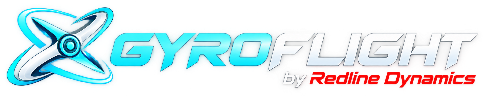

  

  <strong>Flight controller configuration · Blackbox analysis · CHIRP · Safe tuning workflows</strong>

  
  
  
  

# Gyroflight

**Gyroflight**, by **Redline Dynamics**, is a Betaflight-based application for flight controller configuration, flight-log analysis and carefully qualified tuning workflows. It keeps the familiar Betaflight configuration tools and extends them with **GyroCore** analysis and safety-oriented features.

> **Development project:** Gyroflight is not an official Betaflight release. Some analysis features are experimental, and automatic application of GyroCore tuning recommendations is intentionally locked while full safety validation is being completed.

## Features

| Area | What Gyroflight offers |
| --- | --- |
| **Flight controller configuration** | Familiar Betaflight configuration workflow and connectivity |
| **Firmware flasher** | Upstream Betaflight flashing workflow and supported targets; no custom Gyroflight flight firmware |
| **Blackbox Viewer** | Open and inspect flight logs using the Betaflight viewer |
| **CHIRP & Autotune** | Measurement qualification, quality diagnostics and guarded tuning recommendations |
| **GyroCore analysis** | Flight identity, independent A/B flight selection and read-only comparisons |
| **Tuning safety** | Explicit validation gates and an Apply lock for incomplete safety workflows |

GyroCore functionality is under active development and is being integrated gradually. See [the GyroCore architecture](docs/gyrocore/ARCHITECTURE.md), [CHIRP qualification](docs/gyrocore/CHIRP_QUALIFICATION.md) and [safety engine documentation](docs/gyrocore/SAFETY_ENGINE.md) for implementation status and limitations.

## Development status

The current repository branch is **gyroflight/main**. The project contains both the inherited Betaflight App and Gyroflight-specific extensions.

- **Available in the codebase:** Gyroflight branding/home, Betaflight configuration and Blackbox workflows, CHIRP qualification and GyroCore diagnostic components.
- **Under qualification:** complete safety validation and integrated end-to-end tuning workflows.
- **Safety restriction:** GyroCore-generated tuning changes must not be written to a flight controller until the required validation and authorization path is complete.

This development version is **not** a claim of an independently qualified flight-ready tuning system. Always review changes and keep a known-good flight-controller configuration backup.

## Build locally

The project uses Node.js, npm, Vue and Vite. Use the versions specified in [.nvmrc](.nvmrc) and [package.json](package.json).

    git clone https://github.com/sliksoft/gyroflight.git
    cd gyroflight
    git switch gyroflight/main
    npm ci
    npm run dev

For a local production build:

    npm run build

Run the relevant checks before contributing:

    npm run lint
    npm test

For broader platform documentation, consult the [upstream Betaflight App](https://github.com/betaflight/betaflight-configurator). **Betaflight release installers do not contain Gyroflight's extensions.**

## Project structure

| Path | Purpose |
| --- | --- |
| [src/gyroflight/](src/gyroflight/) | Product branding, navigation, UI integration and policy |
| [src/gyrocore/](src/gyrocore/) | Flight analysis, CHIRP, tuning qualification and safety foundations |
| [docs/gyrocore/](docs/gyrocore/) | Architecture, qualification reports and technical decisions |
| [src/blackbox-viewer/](src/blackbox-viewer/) | Upstream Betaflight Blackbox Viewer |

## Betaflight attribution

Gyroflight is a **fork of the [Betaflight App](https://github.com/betaflight/betaflight-configurator)**. It builds on the work of the Betaflight maintainers and contributors; it is not affiliated with or endorsed by the Betaflight project.

Betaflight flight-controller firmware and upstream release channels remain separate from Gyroflight's application extensions.

## License

Gyroflight retains the source project's **GNU General Public License v3.0 (GPL-3.0)**. See [LICENSE](LICENSE) and the existing copyright and attribution notices.

---

  <strong>GYROFLIGHT</strong> · by <strong>Redline Dynamics</strong> 
  Autonomous Flight. Real Performance.

